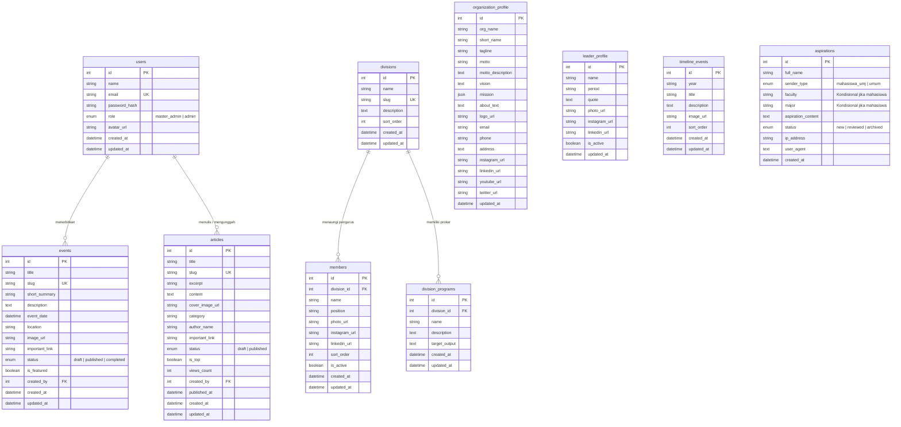

# 📚 Dokumentasi Database: BAPEMA Cakrawala UMJ

**Website Profil & Portal Informasi Lembaga Pers Mahasiswa (LPM)**  
**Universitas Muhammadiyah Jakarta**  
*Penulis / Developer: Habil*  
*Status: Production-Ready Blueprint*

---

## 🗂️ Struktur Direktori Database

```
d:/BAPEMAcakrawalaUMJ/database/
├── bapema.db             # File database SQLite aktif (dapat dibuka langsung di VS Code)
├── init_database.js      # Script pembuat & pengisi database otomatis (Node.js native)
├── test_query.js         # Script pengujian relasi & query data
├── schema.sql            # Skema DDL standar MySQL / MariaDB (Hosting cPanel, VPS, Cloud SQL)
├── schema_postgres.sql   # Skema DDL standar PostgreSQL (Supabase, Neon, AWS RDS)
├── schema_sqlite.sql     # Skema DDL SQLite (Development lokal & test)
├── seed.sql              # Data awal (Users, Profil, Ketua Umum, Divisi, Acara, Artikel, Aspirasi)
├── prisma/
│   └── schema.prisma     # Skema Prisma ORM (Siap diintegrasikan ke Next.js / Express)
└── README.md             # Panduan lengkap dokumentasi database ini
```

---

## 🏗️ Diagram Hubungan Entitas (ERD - Entity Relationship Diagram)



---

## 📋 Daftar & Penjelasan Tabel

### 1. `users` (Manajemen Admin & RBAC)
Menyimpan akun pengurus yang memiliki hak akses masuk portal CMS (`/admin/login`).
- **Role:**
  - `master_admin`: Kontrol mutlak, termasuk hak eksklusif membuka menu `/admin/users` dan mendaftarkan akun admin baru.
  - `admin`: Mengelola konten harian (Dashboard, Tentang Kami, Acara, Artikel, Aspirasi). Tidak bisa menambah admin lain.

### 2. `organization_profile` (Profil & Identitas Organisasi)
Menyimpan narasi Visi, Misi (format JSON array), Motto resmi (*"Suara Cakrawala, Suara Mahasiswa!"*), deskripsi kompas integritas, kontak sekretariat, dan tautan sosial media resmi.

### 3. `leader_profile` (Profil Ketua Umum)
Menyimpan nama, masa periode, sambutan kutipan, foto resmi, dan tautan Instagram & LinkedIn Ketua Umum yang tampil pada kartu khusus di halaman Tentang Kami.

### 4. `divisions` (Divisi Kepengurusan)
Struktur divisi organisasi:
- Redaksi & Peliputan Berita
- Media Kreatif & Multimedia
- Hubungan Masyarakat & Kemitraan
- Penelitian & Pengembangan (Litbang / Kaderisasi)

### 5. `members` (Pengurus per Divisi)
Menyimpan data anggota pengurus yang berelasi ke divisi (`division_id`). Memuat nama, jabatan struktural, foto, dan profil jejaring profesional/LinkedIn.

### 6. `division_programs` (Program Kerja per Divisi)
Program kerja spesifik di setiap divisi beserta target output yang dihasilkan.

### 7. `timeline_events` (Perjalanan Organisasi)
Tonggak sejarah dan pencapaian BAPEMA Cakrawala dari tahun ke tahun untuk komponen timeline interaktif.

### 8. `events` (Acara & Agenda Unggulan)
Katalog agenda kegiatan mendatang maupun arsip dokumentasi kegiatan.
- Dilengkapi kolom `status` (`draft`, `published`, `completed`), `is_featured` (untuk carousel beranda), poster/foto kegiatan, dan tautan penting pendaftaran/panduan.

### 9. `articles` (Portal Berita & Artikel)
Katalog publikasi karya jurnalistik, opini, rilis pers, dan investigasi.
- Dilengkapi penanda `is_top` (untuk artikel headline yang ingin disorot sebagai titik pusat), kategori, counter pembaca (`views_count`), status publikasi (`draft`/`published`), dan tautan referensi.

### 10. `aspirations` (Kotak Aspirasi Mahasiswa & Umum)
Menampung kritik, saran, dan aspirasi masyarakat dan mahasiswa UMJ.
- Menyediakan logika kondisional: jika pengirim adalah `mahasiswa_umj`, kolom `faculty` dan `major` wajib terisi.
- Dilengkapi status tindak lanjut (`new`, `reviewed`, `archived`) dan filter waktu untuk fitur ekspor file spreadsheet Excel (.xlsx).

---

## ⚡ Cara Menjalankan & Menguji di Visual Studio Code

### 1. Inisialisasi Ulang / Refresh Database
Jalankan perintah berikut di terminal:
```bash
node database/init_database.js
```

### 2. Jalankan Query Verifikasi Data
Untuk melihat isi tabel dan integritas relasi:
```bash
node database/test_query.js
```

### 3. Membuka Database di VS Code
Kamu dapat menginstal ekstensi VS Code seperti:
- **SQLite Viewer** (oleh *Florian Klampfer*)
- **SQLTools** (oleh *Matheus Teixeira*)

Cukup klik ganda pada file `database/bapema.db` untuk melihat seluruh tabel, data, dan skema secara visual.

---

## 🚀 Migrasi ke MySQL / PostgreSQL Production

- **Untuk MySQL / MariaDB (cPanel / XAMPP / VPS):**
  Import file `database/schema.sql` dan `database/seed.sql` melalui phpMyAdmin atau terminal MySQL:
  ```bash
  mysql -u root -p < database/schema.sql
  mysql -u root -p bapema_cakrawala < database/seed.sql
  ```

- **Untuk PostgreSQL (Supabase / Neon / Cloud SQL):**
  Jalankan file `database/schema_postgres.sql` dan `database/seed.sql` di SQL Editor dashboard PostgreSQL.

- **Untuk Prisma ORM (Next.js / Node.js):**
  File `database/prisma/schema.prisma` sudah tersedia. Cukup atur `DATABASE_URL` di file `.env` dan jalankan:
  ```bash
  npx prisma db push
  ```
